# Giuseppe CFO — Complete Project Review

Date: 2026-08-04  
Scope: Current state of the local MVP implementation

## 1) Executive summary

Giuseppe CFO is now a **local-first Streamlit + SQLite business-management app** for Giuseppe’s Danish PMV.  
The system includes migration-safe database startup (Alembic), core operational pages, lifecycle workflows for clients/quotes/invoices/expenses, backup + restore safety, CSV/Excel exports, and audit logs.

The app remains private by design:
- no cloud database
- no Google/AI/banking/email integrations
- no telemetry
- local files only

---

## 2) Architecture overview

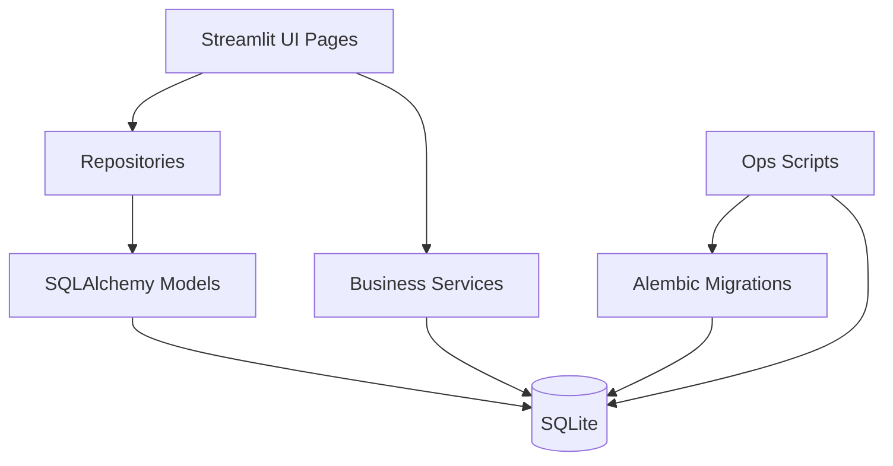

### Main layers
- **UI:** `app/main.py` + `app/pages/*.py`
- **Domain repositories:** `app/repositories/`
- **Domain services:** `app/services/`
- **Validation schemas:** `app/schemas/`
- **Persistence models:** `app/models/`
- **Database lifecycle:** `app/database.py` + Alembic migrations

---

## 3) Folder structure (current)

```text
giuseppe-cfo/
├── app/
│   ├── main.py
│   ├── pages/
│   │   ├── 1_Dashboard.py
│   │   ├── 2_Clients.py
│   │   ├── 3_Quotes.py
│   │   ├── 4_Invoices.py
│   │   ├── 5_Expenses.py
│   │   ├── 6_Documents.py
│   │   ├── 7_Reports.py
│   │   ├── 8_Backup_and_Export.py
│   │   ├── 9_Settings.py
│   │   └── 10_Audit_Log.py
│   ├── models/
│   ├── repositories/
│   ├── schemas/
│   ├── services/
│   └── ui/
├── migrations/
│   ├── env.py
│   └── versions/20260804_0001_initial_schema.py
├── scripts/
├── tests/
├── docs/
│   ├── COMPLETE_REVIEW.md
│   ├── PROJECT_STATUS.md
│   ├── SECURITY.md
│   ├── USER_GUIDE.md
│   ├── DATA_MODEL.md
│   ├── BACKUP_AND_RECOVERY.md
│   ├── CHANGELOG.md
│   └── ...
├── data/private/                (runtime local DB)
├── documents/                   (runtime local files)
├── exports/                     (runtime generated exports)
├── backups/                     (runtime backup zips)
├── review_bundle/               (runtime review zip)
├── alembic.ini
├── run_app.py
├── README.md
└── pyproject.toml
```

---

## 4) Completed features

## Foundation & safety
- Alembic setup and initial migration.
- Migration-aware startup (`initialise_database` + `migrate_database`).
- Safety backup behavior for pre-Alembic existing local schema before stamping.
- Schema head-check support.

## Security/local-only operation
- Optional local password auth (`bcrypt` hash in env).
- Session timeout.
- Local/private bind guard (no public bind addresses).

## Business workflows
- **Clients:** create, update, search/filter, archive, restore, related totals.
- **Quotes:** create, edit draft, status updates, duplicate, convert accepted quote -> draft invoice.
- **Invoices:** create draft, edit draft, send (official numbering), partial/full payments, overdue refresh, cancel, archive, copy.
- **Expenses:** create, update, category/currency support, archive/restore, receipt path field.
- **Documents:** register local document metadata and relationship references.
- **Reports:** year-based summaries, monthly metrics, category summaries, invoice status summaries.
- **Settings:** update business config with audited notable changes.
- **Audit Log:** event listing/filtering.

## Data operations
- CSV exports: clients, quotes, invoices, expenses.
- Excel export workbook with dashboard/reports/settings summary (bank fields excluded by default).
- Backup ZIP creation.
- Restore workflow with typed `RESTORE` confirmation and safety backup.
- Secure review-bundle generation with secret scanning.

---

## 5) Missing / partially implemented features

- Dedicated **sent-invoice correction workflow** (credit-note style) is not yet implemented.
- Document records currently do not have separate archive-state workflow.
- Report depth can be expanded (more advanced analytics and filters).
- PDF generation for invoices/quotes remains deferred.
- UI polish and stricter confirmation UX can still be improved.

---

## 6) Database schema

Main tables:
- `clients`
- `quotes`
- `invoices`
- `expenses`
- `documents`
- `business_settings`
- `audit_logs`
- `alembic_version`

### Key constraints and behavior
- Unique `client_code`
- Unique `quote_number`
- Unique `invoice_number`
- Unique `expense_number`
- Quote numbering: `Q-YYYY-NNN`
- Sent invoice numbering: `GF-YYYY-NNN`
- Cancelled invoice numbers remain reserved
- No CPR field in schema

For full field-level detail, see `docs/DATA_MODEL.md`.

---

## 7) Screenshots of every page

## Home
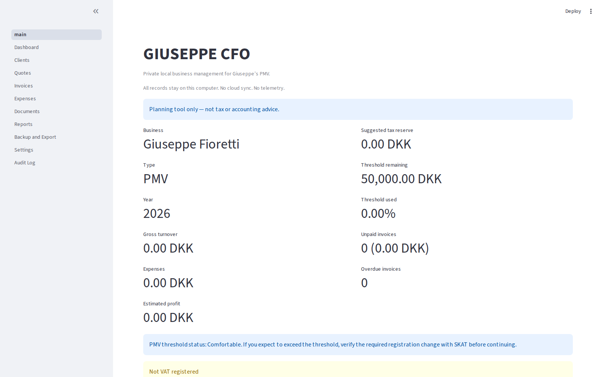

## Dashboard
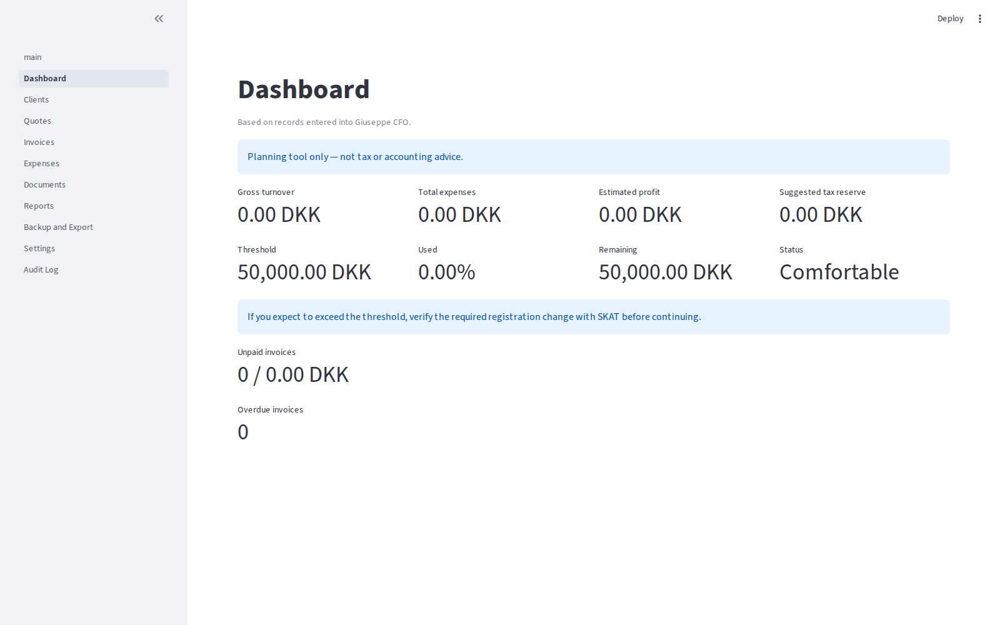

## Clients
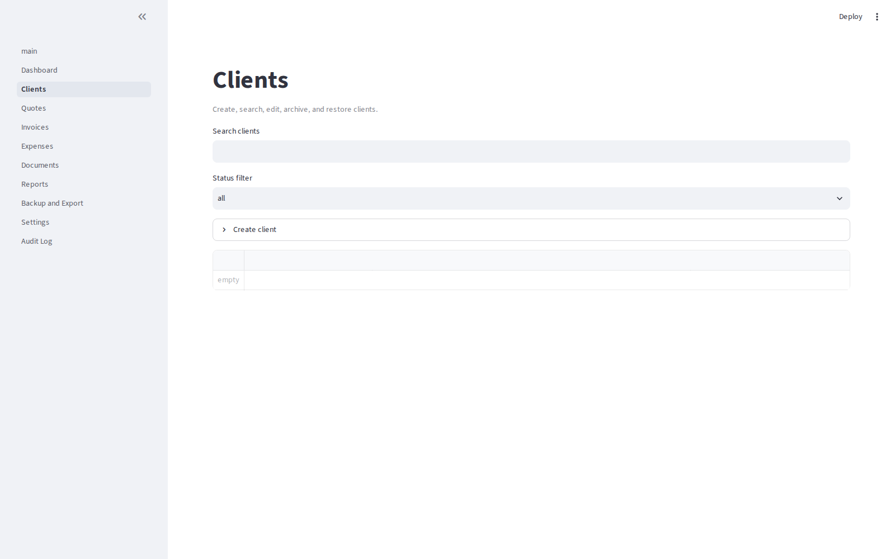

## Quotes
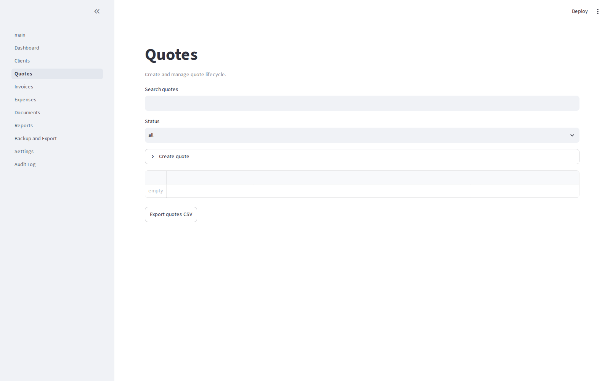

## Invoices
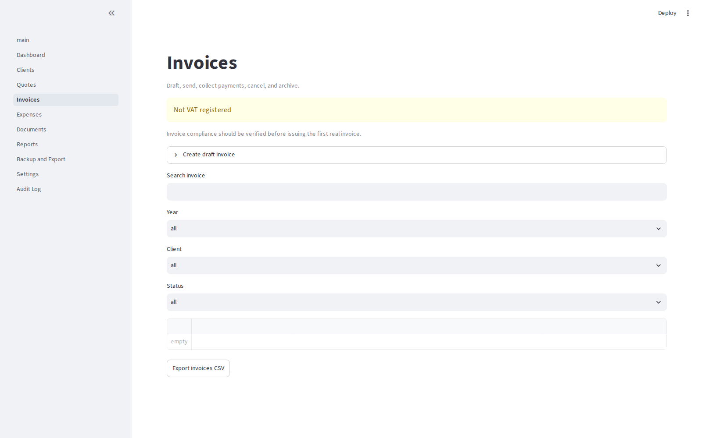

## Expenses
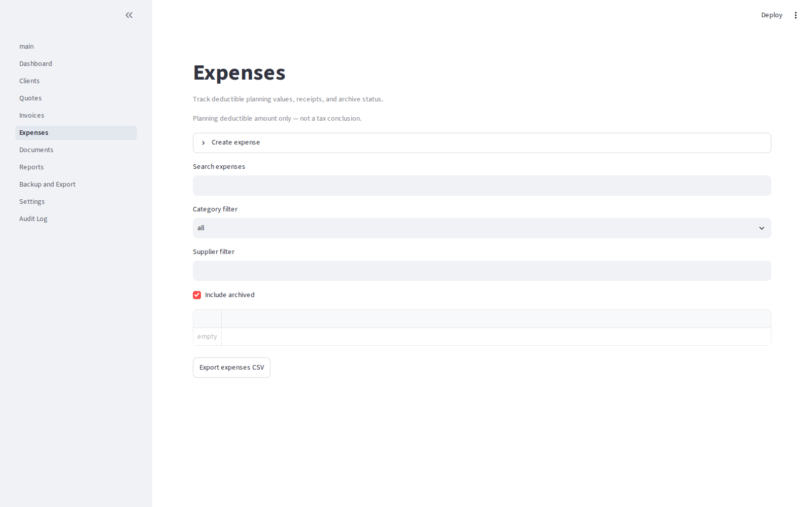

## Documents
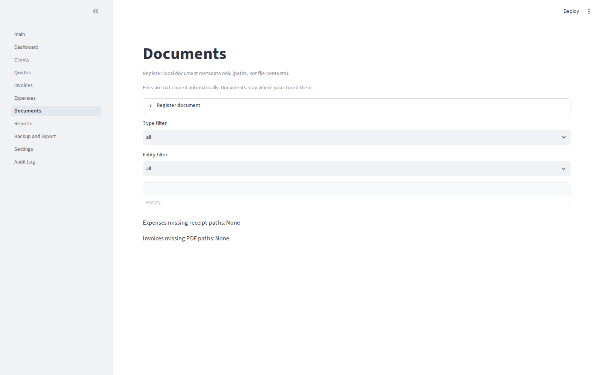

## Reports
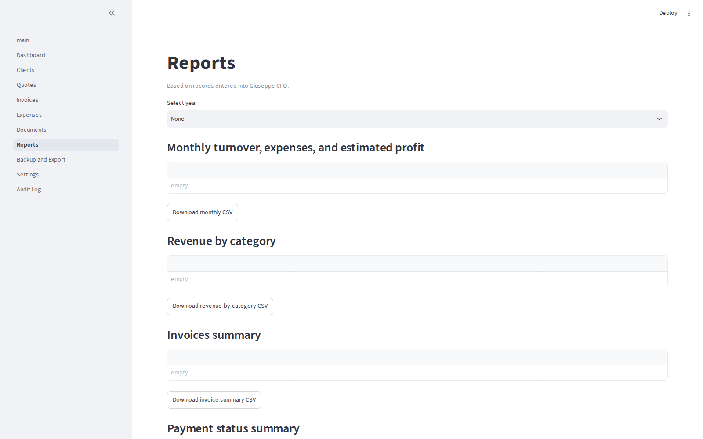

## Backup and Export
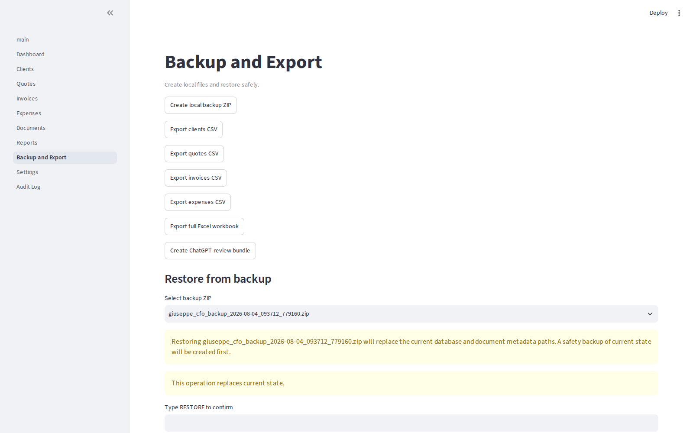

## Settings
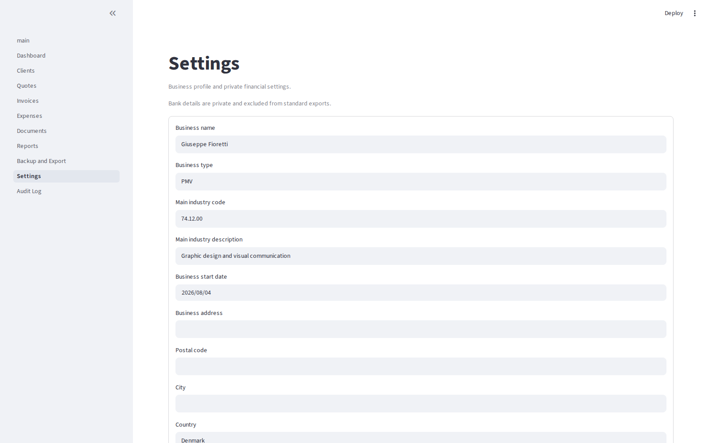

## Audit Log
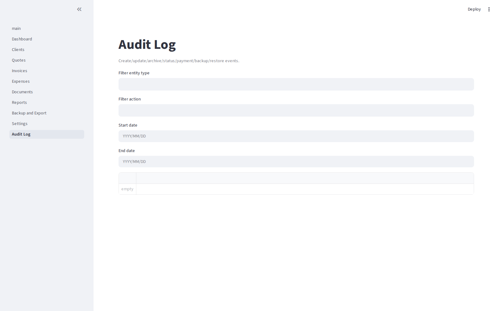

---

## 8) Next roadmap

## Phase 1 (stabilization)
- Implement sent-invoice correction workflow.
- Improve validation feedback and irreversible-action confirmations.
- Expand end-to-end lifecycle integration tests.

## Phase 2 (depth)
- Expand reports (client/category/time slices and downloadable report packs).
- Add document archive semantics and richer missing-file diagnostics.
- Improve UI ergonomics and navigation consistency.

## Phase 3 (operational maturity)
- Add optional local PDF generation for invoices/quotes.
- Add richer audit analytics and change tracing.
- Add guided onboarding/demo-mode (separate temporary DB only).

## Future ideas
- Optional configurable export templates.
- Optional import tools with strict preview/confirmation.
- Additional compliance helpers that remain explicitly non-advisory.

---

## 9) Current quality status

- `pytest`: passing
- `ruff check`: passing
- `ruff format --check`: passing
- `mypy`: passing

This review reflects current committed project behavior and local screenshot captures.
